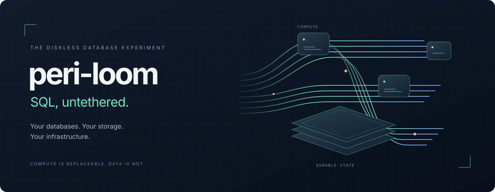

  

<h1 align="center">peri-loom</h1>

  <strong>Your databases. Your storage. Your infrastructure.</strong> 
  A self-hosted, diskless SQL database platform with branching, encryption, and a built-in console.

- 🪶 **Diskless compute** — Keep database storage separate from compute. Worker disks are disposable caches, not your primary database.
- 🌿 **Branch, snapshot, and restore** — Explore changes on separate branches and return to retained recovery points. Snapshots and clones share storage segments within a database namespace.
- 🗄️ **Bring your own S3** — Store database objects in a dedicated bucket on your S3-compatible service.
- 🔐 **Encrypted by design** — Native page encryption, scoped access keys, and TLS-protected connections.
- 🖥️ **A console included** — Browse tables, run SQL, and manage branches and recovery points from your browser.
- 🏢 **Built for multiple projects** — Organize databases by project, with scoped credentials and quotas.
- 🐳 **Deploy with Docker Compose** — One application container. No local compiler or frontend build required.

> **Preview software.** Not ready for production workloads. Clean restart has been verified in tested deployments; crash recovery, disaster recovery, and high availability have not passed production acceptance.
